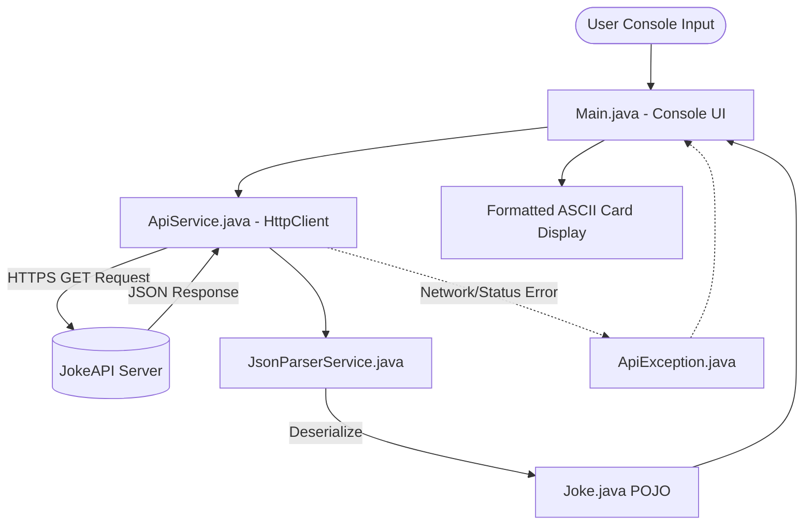

# SaiKet Systems Internship — Task 2: Fetch Data from an API and Display It Using Java


-green?style=for-the-badge)


---

## 📌 1. Project Overview

This repository contains the complete implementation for **Task 2 of the SaiKet Systems Internship Program**. The objective is to build a robust, beginner-friendly Java console application that connects to a free public REST API over HTTPS, retrieves structured JSON data, handles network errors gracefully, and displays the information in an elegant, human-readable terminal format.

The application communicates with **[JokeAPI](https://v2.jokeapi.dev/)**, a free and reliable public API that requires no authentication or paid API keys. All network operations are built using modern standard **`java.net.http.HttpClient`** (introduced in Java 11), and payload deserialization is powered by the industry-standard **Jackson Databind** library.

---

## 🎯 2. Objectives & Key Requirements

- **100% Java Implementation**: Developed exclusively using Java without relying on scripts or auxiliary languages.
- **Native HTTP Communication**: Utilizes Java's built-in `java.net.http.HttpClient` and `HttpRequest` with configurable connection and request timeouts.
- **Robust Error & Status Code Handling**: Validates HTTP status codes (such as `200 OK`, `400 Bad Request`, `404 Not Found`) and intercepts network drops, DNS failures, and server timeouts.
- **Dual Format Support**: Fully handles both **Single-line jokes** and **Two-part jokes** (`setup` & `delivery`).
- **Content Safety**: Enforces the API's `safe-mode` flag to ensure that all retrieved content is workplace-safe and appropriate for internship evaluations.
- **Unit & Integration Tested**: Includes automated JUnit 5 tests verifying mock parsing, live API connectivity, and error handling.

---

## 🚀 3. Features

1. **Interactive Console Menu**: A clean text interface allowing users to fetch jokes by category (`Programming`, `Miscellaneous`, `Pun`, `Any Safe`).
2. **Detailed Metadata View**: Displays joke ID, category, format type, language, and content safety flags alongside the joke text.
3. **Graceful Error Recovery**: Traps network dropouts, DNS resolution errors (`UnknownHostException`), and connection timeouts without application crashes.
4. **Built-in Diagnostic Tools**: Menu options to test error handling for non-existent API endpoints and malformed JSON payloads.
5. **Standalone Executable Fat JAR**: Packaged via Maven Assembly Plugin for single-command execution on any machine with JDK 21+.

---

## 🛠️ 4. Technologies & Tools Used

| Tool / Technology | Version / Specification | Purpose |
| :--- | :--- | :--- |
| **Java Development Kit (JDK)** | JDK 21+ (Compatible with JDK 21, 22, 27) | Core runtime & compiler |
| **HTTP Client** | `java.net.http.HttpClient` | Built-in non-blocking HTTPS client |
| **Build & Dependency Tool** | Apache Maven 3.9+ | Build lifecycle, dependency management, packaging |
| **JSON Parser** | Jackson Databind `2.18.2` | High-performance, schema-safe JSON deserialization |
| **Testing Framework** | JUnit Jupiter (JUnit 5) `5.11.4` | Automated unit and integration testing |
| **Target IDE** | Visual Studio Code / Eclipse / IntelliJ | Development & execution environment |

---

## 🌐 5. Public API Information

* **Service**: [JokeAPI](https://v2.jokeapi.dev/)
* **Endpoint Pattern**: `https://v2.jokeapi.dev/joke/{category}?safe-mode`
* **Authentication**: None required (100% Free & Open)
* **HTTP Method**: `GET`
* **Response Format**: `application/json`

### Sample Response Types:

#### 1. Single-Part Joke:
```json
{
  "error": false,
  "category": "Programming",
  "type": "single",
  "joke": "There are 10 types of people: those who understand binary, and those who don't.",
  "id": 42,
  "safe": true,
  "lang": "en"
}
```

#### 2. Two-Part Joke (Setup & Delivery):
```json
{
  "error": false,
  "category": "Programming",
  "type": "twopart",
  "setup": "Why do programmers wear glasses?",
  "delivery": "Because they need to C#",
  "id": 49,
  "safe": true,
  "lang": "en"
}
```

---

## 📁 6. Project Structure

```
Task2_API_Project/
├── pom.xml                                   # Maven dependencies & build configuration
├── README.md                                 # Complete documentation & internship guide
├── .gitignore                                # Git ignore configuration for Java & Maven
├── .vscode/                                  # Visual Studio Code configurations
│   ├── launch.json                           # 1-click debug & run configuration
│   └── settings.json                         # Workspace compiler & encoding settings
└── src/
    ├── main/
    │   └── java/
    │       └── com/
    │           └── saiket/
    │               └── task2/
    │                   ├── Main.java              # Interactive console UI & menu loop
    │                   ├── ApiService.java        # HTTPS client & network exception handling
    │                   ├── JsonParserService.java # Jackson JSON parsing & validation
    │                   ├── Joke.java              # POJO model with dual single/twopart support
    │                   └── ApiException.java      # Custom exception for clean error reporting
    └── test/
        └── java/
            └── com/
                └── saiket/
                    └── task2/
                        └── ApiAndJsonParserTest.java # JUnit 5 test suite (7 tests)
```

---

## 🧠 7. Code Architecture & Component Explanation



### Explanation of Core Classes:

1. **`Main.java`**:
   - Acts as the console entry point.
   - Presents an interactive menu (`1-7`) and handles user input validation.
   - Formats the retrieved data into clean ASCII cards with automatic text wrapping.
   - Properly closes standard input resources upon exit.

2. **`ApiService.java`**:
   - Manages the `java.net.http.HttpClient` instance with a **10-second connection timeout** and **10-second request timeout**.
   - Sends HTTPS `GET` requests with appropriate headers (`Accept: application/json`, custom `User-Agent`).
   - Checks the response status code (`200 OK`) and wraps HTTP errors or low-level I/O issues into friendly `ApiException` instances.

3. **`JsonParserService.java`**:
   - Uses Jackson's `ObjectMapper` configured with `FAIL_ON_UNKNOWN_PROPERTIES = false`.
   - Safely parses JSON strings into `Joke` objects.
   - Detects and handles malformed JSON, unclosed tokens, and null inputs.

4. **`Joke.java`**:
   - Object-Oriented Data Model (POJO) mapped to JokeAPI fields.
   - Includes helper methods `isSingle()`, `isTwoPart()`, and safe fallback accessors.

5. **`ApiException.java`**:
   - Custom checked exception storing both the human-readable diagnostic message and the underlying HTTP status code.

---

## 💻 8. Installation & Setup Instructions

### Prerequisites:
- **JDK 21 or higher**: Verify by running `java -version` and `javac -version`.
- **Apache Maven 3.9+**: Verify by running `mvn -version`.
- **Visual Studio Code** (or any preferred Java IDE).

---

## 🖥️ 9. How to Run in Visual Studio Code

### Method 1: Using VS Code 1-Click Run
1. Open Visual Studio Code.
2. Select **File > Open Folder...** and select this project directory (`Task2API`).
3. Ensure the **Extension Pack for Java** (by Microsoft) is installed.
4. Open `src/main/java/com/saiket/task2/Main.java`.
5. Click the **Run** button (or press `F5`).
6. The interactive menu will run directly in the VS Code Integrated Terminal.

### Method 2: Running via Maven Terminal Command
Open the integrated terminal in VS Code (`Ctrl + ~`) and execute:
```powershell
mvn clean compile exec:java
```

### Method 3: Running the Standalone Executable Fat JAR
Build and run the single executable JAR (bundles all dependencies):
```powershell
mvn clean package
java -jar target/SaiKet-Task2-App.jar
```

---

## 📊 10. Sample Output

### Successful Run (Two-Part Joke):
```text
==========================================================================
               SAIKET SYSTEMS - INTERNSHIP TASK 2 (JAVA)                  
                Fetch Data from a Public API and Display It               
                       Version 1.0.0 | JDK 21+                      
==========================================================================

=========================== MAIN MENU ===========================
  [1] Fetch a Programming Joke (Safe-Mode)
  [2] Fetch a Miscellaneous / General Joke
  [3] Fetch a Wordplay / Pun Joke
  [4] Fetch a Joke from Any Safe Category
  [5] Test Error Handling (Invalid API Endpoint)
  [6] Test Parser Error Handling (Malformed JSON Simulation)
  [7] Exit Application
=================================================================
[>] Enter your choice (1-7): 1

--------------------------------------------------------------------------
[INFO] Connecting to JokeAPI (HTTPS) to fetch a Programming Joke...
       Target Endpoint : https://v2.jokeapi.dev/joke/Programming?safe-mode
       HTTP Method     : GET
       HTTP Client     : java.net.http.HttpClient
[SUCCESS] HTTP 200 OK received! Payload parsed successfully.

+========================================================================+
|                     SAIKET SYSTEMS - API DATA VIEW                     |
|------------------------------------------------------------------------|
| Category         : Programming                                         |
| Joke ID          : #49                                                 |
| Format Type      : Two-Part (Setup & Delivery)                         |
| Language         : EN                                                  |
| Content Safety   : Safe (Safe-Mode Enforced)                           |
|------------------------------------------------------------------------|
| [SETUP]                                                                |
|   Why do programmers wear glasses?                                     |
|                                                                        |
| [PUNCHLINE / DELIVERY]                                                 |
|   Because they need to C#                                              |
+========================================================================+

Press [ENTER] to return to the main menu...
```

### Error Handling Verification (Invalid Endpoint Simulation):
```text
[>] Enter your choice (1-7): 5

--------------------------------------------------------------------------
[TEST] Diagnostic Test: Requesting an invalid category endpoint...
       Target Endpoint : https://v2.jokeapi.dev/joke/InvalidCategoryXYZ

[PASSED] The application gracefully intercepted the API error:
         Error Message : HTTP request failed with status code: 400 - No matching joke found
         HTTP Status   : 400
         Result        : Handled gracefully without crash.
```

---

## 🧪 11. Automated Testing Instructions

The project includes 7 automated tests covering unit deserialization, malformed JSON detection, and live network integration:

Execute the tests with Maven:
```powershell
mvn test
```

### Test Results Summary:
```text
[INFO] Running com.saiket.task2.ApiAndJsonParserTest
[INFO] Tests run: 7, Failures: 0, Errors: 0, Skipped: 0
[INFO] BUILD SUCCESS
```

---

## 🔧 12. Common Troubleshooting & Solutions

| Issue | Likely Cause | Solution |
| :--- | :--- | :--- |
| `'java' or 'javac' is not recognized` | Java is not added to system `PATH` | Set `JAVA_HOME` environment variable pointing to your JDK folder and add `%JAVA_HOME%\bin` to system `PATH`. |
| `'mvn' is not recognized` | Maven is not installed or not in `PATH` | Install Apache Maven and add the `bin` directory to your system `PATH`. |
| `UnknownHostException` | Internet disconnection or DNS blockage | Reconnect to Wi-Fi/Ethernet or verify your DNS server. |
| `HttpTimeoutException` | Slow network or proxy latency | The application allows up to 10 seconds. Check firewall or VPN settings. |
| Non-ASCII characters in console | Terminal encoding mismatch | The application uses standard ASCII borders. In Windows PowerShell, ensure `chcp 65001` if UTF-8 characters are used. |

---

## 📋 13. SaiKet Systems Internship Submission Checklist

- [x] Java is the only programming language used.
- [x] Uses Java built-in `java.net.http.HttpClient`.
- [x] Connects to a free, public API without hardcoded fake responses.
- [x] Implements timeouts, status code validation, and error handling.
- [x] Supports both single-part and two-part JSON response formats.
- [x] Robust parsing with Jackson library via Maven.
- [x] Fully tested with automated JUnit 5 test cases.
- [x] Professional console UI with menu, formatted view, and diagnostic options.
- [x] Configured for Visual Studio Code (`launch.json` & `settings.json`).
- [x] Clean repository without secrets or temporary build files.

---

## 🎥 14. Demonstration Video & Screenshot Guide

1. **Launch VS Code**: Open the `Task2API` folder in VS Code.
2. **Open Terminal**: Press ``Ctrl + ` `` to open the VS Code Integrated Terminal.
3. **Run Application**: Type `java -jar target/SaiKet-Task2-App.jar` and press Enter.
4. **Demonstration Steps**:
   - Show the Startup Banner and Main Menu.
   - Select option `1` to fetch a Programming Joke.
   - Select option `3` to fetch a Pun / Wordplay Joke.
   - Select option `5` to demonstrate live API error handling (400 Bad Request intercept).
   - Select option `6` to demonstrate malformed JSON protection.
   - Select option `7` to demonstrate clean application exit.
5. **Capture**: Use `Windows Key + Shift + S` for screenshots or `Windows Key + Alt + R` (Xbox Game Bar) / OBS Studio for screen recording.

---

### Author & Candidate
* **Candidate**: Siddharth K
* **Task**: Task 2 — Fetch Data from an API and Display It Using Java
* **Internship Program**: SaiKet Systems
